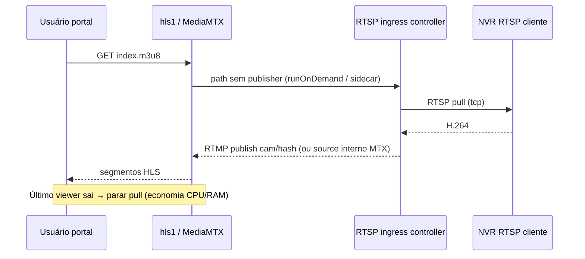

# ConfVision — RTSP pull: ao vivo (HLS) e plano de desenvolvimento

**Status:** cadastro e analítico RTSP **implementados**; ao vivo HLS **validado só com relay manual** (2026-10-06).  
**Fonte operacional:** PostgreSQL `vis_camera` (ConfCam / `home/confmonit/v4.0/confcam`).  
**Xano:** congelado — nenhuma fase abaixo cria recurso novo no Xano.

---

## 1. Problema e objetivo

Câmeras/NVRs que **não publicam RTMP** expõem **RTSP** na rede do cliente. O portal ConfVision reproduz ao vivo via **HLS**:

```text
https://hls1.dnsid.com.br/cam/{hash12}/index.m3u8
```

O `{hash12}` é sempre o path MediaMTX `cam/{hash}` (Hashids do `vis_camera.id`), igual ao modo **RTMP push**.

**Objetivo de produto:** com `fonte_ingresso = rtsp_pull`, o cliente **não** cola URL RTMP no equipamento; o ConfMonit **ingere RTSP** e o franqueado vê ao vivo no mesmo player (`live-player.js`) e mosaico.

**Objetivo de infra:** custo **idle ≈ zero** — sem ffmpeg 24/7 por câmera; alinhar com `hlsAlwaysRemux: no` (remux HLS só quando há viewer).

---

## 2. Estado atual (baseline)

| Camada | RTMP push | RTSP pull |
|--------|-----------|-----------|
| Postgres `fonte_ingresso`, `rtsp_url_sec` | `rtmp_push` (default) | `rtsp_pull` + URL origem |
| ConfCam formulário / teste RTSP | Aba URL RTMP | Aba RTSP + `POST /api/cameras/{id}/test-rtsp` |
| Worker analítico (`urls.py` → `rtsp_url_for_camera`) | RTSP interno MTX ou URL sec | Lê **RTSP do cliente** |
| `SyncStreamStatusFromGuard` / `status=online` | Sim (publish RTMP) | **Ignorado** (`rtsp_pull` excluído do backfill) |
| HLS ao vivo | Publish na câmera → MTX | **Não automático** — exige relay ou publish manual |
| Licença / `pode_stream` | `online` ou `ativo` | Idem (`urls.js`, guard) |

Migration: `confcam/sql/023_vis_camera_fonte_ingresso.sql`.

**Prova de cadeia (teste 2026-10-06, câmera id=34, path `cam/kbjmpxv7y4r6`):**

1. RTSP origem OK (1280×720).
2. Relay temporário RTSP → `rtmp://srv1.dnsid.com.br:1935/cam/kbjmpxv7y4r6/` (ffmpeg, `-c:v copy`).
3. HLS retornou `#EXTM3U` HTTP 200.

Script ops/dev: `confcam/scripts/rtsp_relay_hls_test/main.go` (ver README no mesmo diretório).

---

## 3. Arquitetura alvo

### 3.1 Duas pernas (não confundir)

```text
                    ┌─────────────────────────────────────┐
  RTSP cliente      │  ConfMonit / VPS (worker-vpsN)       │
  (rtsp_url_sec) ───┼──► Analítico / snapshot / gravação   │  ← já existe
                    │                                     │
                    │  Ingresso ao vivo (A IMPLEMENTAR)   │
                    │       │                             │
                    │       ▼                             │
                    │  MediaMTX path cam/{hash12}         │
                    │       │                             │
                    │       ▼                             │
                    │  HLS hls1…/cam/{hash}/index.m3u8    │  ← portal
                    └─────────────────────────────────────┘
```

### 3.2 Fluxo desejado (sob demanda)



### 3.3 Opções de implementação (comparativo)

| Opção | Descrição | Idle CPU | Complexidade | Recomendação |
|-------|-----------|----------|--------------|--------------|
| **A — Relay ffmpeg gerenciado** | Sidecar na VPS do `worker_id`: lista `rtsp_pull`, inicia/para ffmpeg → RTMP | Baixo se **só com viewers** | Média | **MVP (Fase 2)** — reutiliza guard/ path atuais |
| **B — MediaMTX `source` + `sourceOnDemand`** | Path `cam/{hash}` com URL RTSP vinda do Postgres (API/hook) | Baixo | Média–alta (paths dinâmicos + segredo RTSP) | **Fase 3** — menos processos que N ffmpegs |
| **C — Relay 24/7 por câmera** | ffmpeg contínuo | **Alto** | Baixa | **Não** usar em escala |
| **D — Cliente publica RTMP** | Tratar como `rtmp_push` | Depende da câmera | N/A | Só se instalador converter no site |

**PROPOSTA ARQUITETURAL:** entregar **A (MVP)** com política **on-demand** (ver §5); evoluir para **B** se N relays ffmpeg por nó virar gargalo.

---

## 4. Regras de produto (licença e UI)

- **Todas as licenças** podem expor o **mesmo** HLS `cam/{hash}`; `confVisionCameraPodeStream`: plano `online` **ou** câmera ativa, não bloqueada.
- **Plano `online`:** ao vivo sob demanda; **sem** worker analítico (`ListCamerasAnaliticas` exige `deteccao_humano` + `ativo`).
- **Aba URL ConfCam:**
  - `rtmp_push` → “cole RTMP na câmera”.
  - `rtsp_pull` → dados RTSP + (futuro) bloco **“Ao vivo (HLS)”** somente leitura (path + link teste), **sem** RTMP para o cliente.
- **`status=online`:** hoje ligado ao guard RTMP; para RTSP, Fase 4 deve considerar publish ativo **ou** sessão HLS/pull ativa.

---

## 5. Plano de ação e desenvolvimento (fases)

### Fase 1 — Cadastro RTSP ✅ (concluída)

- [x] Coluna `fonte_ingresso`, API, formulário, teste RTSP.
- [x] Worker lê `rtsp_url_sec` externo.
- [x] Documentar gap HLS (hint no formulário).

**Critério de aceite:** salvar câmera RTSP, teste conexão OK, analítico elegível quando plano/flags permitirem.

---

### Fase 2 — Relay ops + MVP controlado (curto prazo) — **implementado (código)**

**Entrega:** serviço **`confvision-rtsp-relay`** (`rtsp_live_relay_main.py`) no stack da VPS / EasyPanel, ao lado do worker.

| Item | Detalhe |
|------|---------|
| Entrada | Lista câmeras `fonte_ingresso=rtsp_pull`, `worker_id` do nó, `rtsp_url_sec` via API vis (`vis_camera_sync_ativas` ou endpoint dedicado **somente leitura** Postgres) |
| Saída | Publish RTMP `cam/{hash}` (respeitar `protocolo` dvr → barra final) |
| Política v1 | **On-demand:** iniciar relay quando houver viewer HLS (webhook MTX, poll API paths, ou sinal do portal — definir na implementação) |
| Política v0 (ops) | Script manual `rtsp_relay_hls_test` para homologação |
| Observabilidade | Log `[RTSP-RELAY] start/stop camera_id= path=`; métrica processos ativos por nó |
| Segurança | RTSP URL **nunca** logar em info (usar `-loglevel error` no ffmpeg); credenciais só Postgres/API |

**Critérios de aceite:**

- Câmera RTSP de teste: abrir ao vivo no portal → vídeo em ≤15 s sem rodar script manual na estação do dev.
- Parar visualização → relay para em ≤2 min (configurável).
- Guard continua validando publish por path/hash (sem mudar contrato).

**Artefatos:**

- `confvision/rtsp_live_relay.py`, `rtsp_live_relay_main.py`, `vis_api_auth.py`
- ConfCam: `vis_camera_query_rtsp_pull`, `POST /vis_rtsp_relay/wake`, `POST /api/cameras/{id}/rtsp-live-wake`, migration `024_vis_camera_rtsp_live_wake.sql`
- `live-player.js` — wake antes do HLS em `rtsp_pull`
- Deploy: `DEPLOY_EASYPANEL.md` § **2b**
- Homologação manual: `confcam/scripts/rtsp_relay_hls_test/README.md`

**Deploy pendente:** subir serviço na VPS + migration 024 em produção + `XANO_BASE_URL` apontando para API vis com Postgres.

---

### Fase 3 — Pull nativo MediaMTX (médio prazo)

- Configurar paths dinâmicos `cam/{hash}` com `source: rtsp://…` e **`sourceOnDemand: yes`** (confirmar versão MediaMTX em produção).
- Serviço **registrador de paths** (ConfCam ou sidecar): ao salvar câmera `rtsp_pull`, PATCH API MediaMTX ou reload config por nó (`vis_mediamtx_node_id`).
- RTSP URL com credenciais: armazenar em `rtsp_url_sec` (já existe); **não** expor em API pública.
- Manter `hlsAlwaysRemux: no`.

**Critério de aceite:** ao vivo RTSP sem processo ffmpeg dedicado por câmera idle; CPU medida com 0 viewers ≈ baseline do nó.

---

### Fase 4 — Status, health e analítico + ao vivo

| Tarefa | Motivo |
|--------|--------|
| Estender health/`status` para `rtsp_pull` | UI “stream online” coerente |
| Evitar **dupla** leitura RTSP | Se analítico + ao vivo simultâneos, preferir worker ler `rtsp://…:8554/cam/{hash}` **interno** quando relay/MTX estiver ativo |
| Snapshot em `rtsp_pull` | Já usa ffmpeg no Go; alinhar timeouts com relay |

**Critério de aceite:** mosaico mostra online quando HLS disponível; analítico não abre 2ª sessão RTSP na origem quando uma perna MTX já existe.

---

### Fase 5 — UX ConfCam / ConfVision

- Aba URL: bloco **Path ao vivo** (`path`, link HLS, botão “Testar HLS” com resultado amigável).
- Mensagens claras: RTSP cadastrado ≠ ao vivo até ingresso ativo.
- Documentação instalador (1 página PDF/wiki): firewall, porta RTSP, DDNS, plano online vs analítico.

---

## 6. Runbook — teste manual (homologação)

Pré-requisitos: `POSTGRES_URL` no `.env` local **confcam**; ffmpeg no PATH; rede alcança RTSP e porta **1935** RTMP.

```powershell
$env:FFMPEG_PATH = "$env:LOCALAPPDATA\Microsoft\WinGet\Links\ffmpeg.exe"
cd C:\sistemaconfmonit\core4\home\confmonit\v4.0\confcam
go run ./scripts/rtsp_relay_hls_test/ 34
```

Em outro terminal:

```powershell
curl.exe -sS -L "https://hls1.dnsid.com.br/cam/kbjmpxv7y4r6/index.m3u8"
```

Esperado: `#EXTM3U`. Portal: `/ao-vivo/34` ou aba Ao vivo na edição.

Teste HLS sem relay (deve falhar):

```powershell
go run ./scripts/hls_path_check/
```

---

## 7. Riscos e limites

| Risco | Mitigação |
|-------|-----------|
| RTSP da VPS ≠ RTSP da PC do instalador | Teste RTSP **da VPS** (`worker_id`) |
| Credenciais em logs ffmpeg | `-loglevel error`; mascarar URL nos scripts |
| N mosaicos = N pulls | On-demand + limite de tiles; plano online |
| Guard nega publish | Licença `em_uso`, não bloqueada, `ativo` ou plano `online` |
| Xano custo | Toda config via Postgres/API ConfCam |

---

## 8. Referências no repositório

| Caminho | Conteúdo |
|---------|----------|
| `home/confmonit/v4.0/confcam/sql/023_vis_camera_fonte_ingresso.sql` | Schema |
| `home/confmonit/v4.0/confcam/src/modulos/visdata/camera_ingresso.go` | RTSP URL, teste |
| `home/confmonit/v4.0/confcam/src/modulos/visdata/camera_stream_health.go` | Backfill status (exclui rtsp_pull) |
| `confvision/urls.py` | Worker: origem RTSP |
| `confvision/rtmp_guard.py` | Auth publish/read path `cam/{hash}` |
| `confvision/DEPLOY_EASYPANEL.md` | MediaMTX, `hlsAlwaysRemux: no` |
| `confcam/recursos/modulos/confvision/live-player.js` | Player HLS |
| `confcam/scripts/rtsp_relay_hls_test/` | Relay manual homologação |
| `confcam/scripts/hls_path_check/` | Smoke test HLS + decode hash (requer `RTMP_PUBLISH_SECRET` local) |

---

## 9. Ordem sugerida de implementação (sprint)

1. **Fase 2 v0:** documentar deploy relay na VPS `worker-vps1` (systemd ou container one-shot) — ops.
2. **Fase 2 v1:** daemon on-demand + API mínima “viewer count” ou integração MTX.
3. **Fase 5:** UI HLS/path na aba URL (`rtsp_pull`).
4. **Fase 4:** status online + deduplicar RTSP analítico/ao vivo.
5. **Fase 3:** spike MediaMTX `sourceOnDemand` em staging.

**Definition of Done (produto RTSP ao vivo):** instalador cadastra RTSP, testa conexão, cliente abre ao vivo no portal **sem** RTMP no NVR e **sem** script manual na VPS de produção.

---

*Última atualização: 2026-10-06.*
